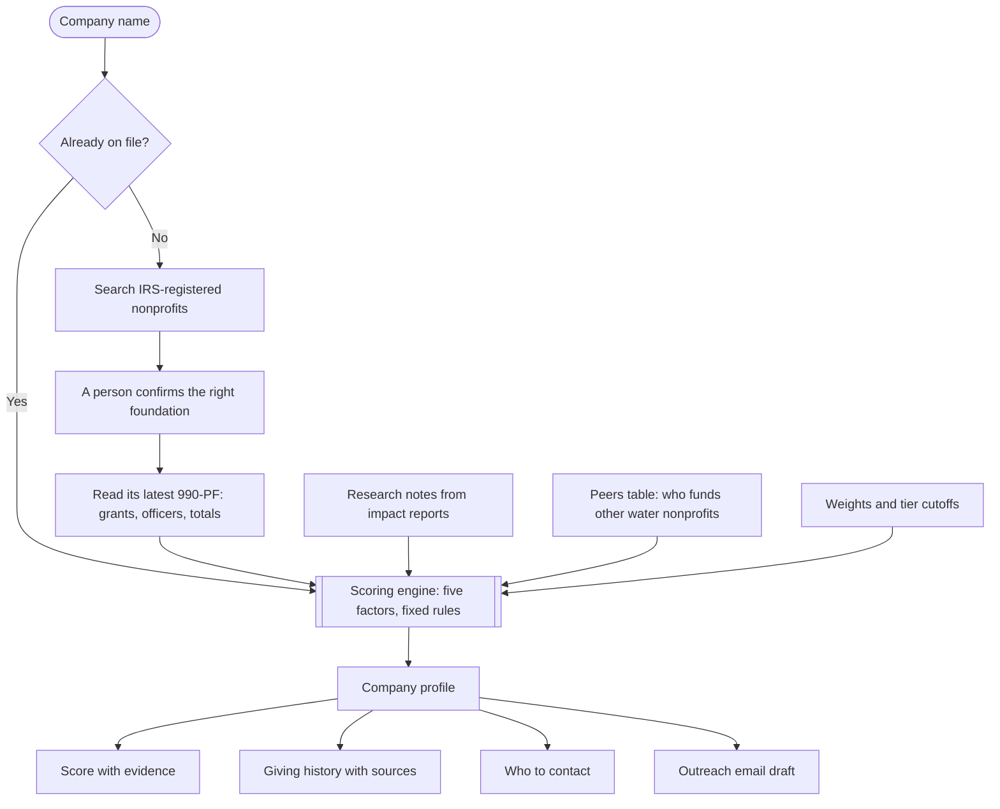

# Sponsor Scout

Corporate sponsor research for Thirst Project. Type in any company and get its giving history, the water nonprofits it already funds, who to contact, a starting outreach email, and a score that says whether it is worth pursuing.

**Shared workspace:** https://sponsor-scout-jeffreyli1717-2803.vercel.app (team access required)

**Original public demo:** https://sponsor-scout-lime.vercel.app

The scoring is rules-based. Every point on a profile links back to an IRS filing, the Peers table or a research note, so anyone can check where a number came from.

## What a profile shows

- **Score and tier**, with the evidence behind each of the five factors
- **Giving history**: grants paid by year, the spread of grant sizes, and a searchable list of every grant
- **Support for other water nonprofits**, pulled from the foundation's own filing
- **Who to contact**: roles to look for, foundation officers, and LinkedIn search links
- **Outreach email**: a draft chosen by industry, ready to edit and log

## How it works



The confirmation step matters. Family foundations, scholarship funds and employee trusts often carry a company's name, so a person picks the right match before anything is scored.

Filings cannot say what a company states as its priorities or how it takes applications. The Research notes panel on each profile captures that, and the score updates on save. Companies without a foundation file no 990-PF, so their profiles stay provisional until someone spends about ten minutes with the company's impact report.

## Scoring at a glance

Each factor is scored 0 to 100. The overall score is the weighted average.

| Factor | Weight | The question it answers |
| --- | --- | --- |
| Mission alignment | 30% | Does the company already care about water access? |
| Peer signal | 20% | Has it funded organizations like Thirst Project? |
| Capacity fit | 20% | Can it give at the level Thirst Project would ask for? |
| Accessibility | 20% | How reachable is the decision maker? |
| Confidence | 10% | How much of the above rests on evidence? |

| Tier | Score | Meaning |
| --- | --- | --- |
| A | 65 and up | Pursue now |
| B | 50 to 64 | Strong prospect |
| C | 35 to 49 | Worth a closer look |
| D | Under 35 | Low priority |

A factor with no evidence is held at a neutral value and the company is marked provisional, so a thin profile never looks as settled as a researched one. The Method page in the app lists every rule and its point value.

## What it costs to run

The public-data demo needs no paid services. Shared team storage uses a private Google Sheet and a free Apps Script web app. Server-only credentials and a team access key are required for shared mode.

| Piece | How it stays free |
| --- | --- |
| Filing data | Two keyless public sources: the ProPublica Nonprofit Explorer API for foundation search and yearly totals, and the GivingTuesday 990 Data Lake for the IRS e-file records that hold grant lists and officers |
| Starter companies | Bundled with the app as JSON, so their profiles need no outside calls |
| Team data | In shared mode, company data, research, lookups, outreach, weights and filing snapshots live in the private team Sheet. Local demo mode uses browser storage |
| Hosting | Next.js on Vercel. Shared mode also reads and writes the private Sheet through server routes |

## Run it locally

Requires Node 24 or newer for the current toolchain.

```bash
npm install
npm run dev
```

Open http://localhost:3000.

| Command | What it does |
| --- | --- |
| `npm test` | Runs scoring, filing, matching, import, storage, authentication and Apps Script tests |
| `npm run build` | Production build |
| `npm run seed` | Re-pulls the latest filings for the starter list |

## Deploying

Deploy as a Next.js project using Node 24. Local demo mode needs no environment variables. Shared team mode requires the three server-only variables documented in [docs/SHEET_SYNC.md](docs/SHEET_SYNC.md). Connect a Git branch in Vercel if automatic deployments are desired; source-file deployments do not establish a Git integration.

Vercel's free Hobby plan is for non-commercial use. If Thirst Project takes this over as an organization, check that plan's terms or apply for a nonprofit plan.

## Optional settings

Local demo mode runs with none of these set. They are listed in `.env.example`.

| Variable | What it turns on |
| --- | --- |
| `PARTNER_COMPANIES` | A comma-separated list of existing Thirst Project partners. Matching companies get a notice on their profile and the outreach draft is turned off. Kept out of the repository because the list is private |
| `HUNTER_API_KEY` | Work email lookup for foundation officers through Hunter.io (free tier, 50 credits a month). One credit per lookup, only when someone asks |
| `SHEET_WEBHOOK_URL`, `SHEET_WEBHOOK_SECRET` | Connects the private Google Sheet as the shared data store (also requires `TEAM_ACCESS_KEY`). Setup is in [docs/SHEET_SYNC.md](docs/SHEET_SYNC.md) |

The Google Sheets integration now reads and writes shared data with authenticated sessions, conflict detection and explicit save status. See `docs/SHEET_SYNC.md` for setup, verification and limitations. Hunter lookup still requires a separately configured key.

## Working with the data

| File | What it holds |
| --- | --- |
| `data/companies.json` | The starter companies: industry, web domain, matched foundation, research notes |
| `data/filings/<ein>.json` | A snapshot of each matched foundation's latest filing |
| `data/peers.json` | The Peers table: companies that have funded other water nonprofits |
| `data/peer-orgs.json` | Water nonprofits recognized in filings, with name variants |
| `data/weights.json` | Factor weights, tier cutoffs and neutral baselines |
| `scripts/seed-list.json` | The list `npm run seed` builds from |

**Add a company to the starter set.** Add it to `scripts/seed-list.json`, then run `npm run seed`. To find the right foundation and its EIN first, run `npx tsx scripts/find-foundations.ts`. Research notes already saved in `data/companies.json` are kept.

**Add a sponsorship found in an annual report.** Add a row to `data/peers.json` with any `relationship` other than `Foundation grant`. Rows with that exact value are regenerated from filings on each seed.

**Make research notes permanent.** Shared mode saves notes to Profiles in the private Sheet. For a public demo, export notes from Tracker and copy approved public values into the company's `research` block in `data/companies.json`.

**Change how companies are scored.** Weights and tier cutoffs are in `data/weights.json`, and the Method page lets you try new weights in the browser first. Point values for each rule are in `src/lib/scoring.ts`, each with a test in `tests/scoring.test.ts`. Water keywords are in `src/lib/keywords.ts`.

## State of the starter data

There are 54 organizations on file: the original 33 companies and 21 additional organizations from the gala history. Six profiles have sourced LA location evidence. Giving priorities still require manual research. The private shared Sheet adds 37 organization gala sponsorship records; these amounts and personal donor records are not bundled in this public repository.

- **Of the original 33 companies, 21 have a matched foundation**, nine have no foundation found and three have unconfirmed matches (Procter & Gamble, Microsoft, YETI). An unsuccessful search does not prove that no foundation exists.
- **Imported organizations have no assumed foundation match.** Their private gala history provides separate sponsorship evidence in shared mode.
- **Foundation matches were chosen by name and city.** Verify a match before relying on it for outreach.
- **Outreach templates are starting drafts.** Text in [brackets] is for the sender to fill in, and the wording should be reviewed by Thirst Project before the team uses it.

## Privacy

The app reads public IRS filings. It does not scrape LinkedIn, does not use paid contact databases, and does not collect personal emails or phone numbers. LinkedIn links open a search in the user's own browser.

## Project layout

```
src/app            Pages and API routes
src/components     Interface components
src/lib            Scoring, filing parser, data sources, templates
data               The bundled dataset and scoring configuration
scripts            Seeding scripts
tests              Unit tests, including one against a real 990-PF
docs               Shared Google Sheet storage setup
```

## LA presence and sponsorship evidence

Accessibility reserves 35 points for sourced local presence and caps other access evidence at 65. California alone no longer earns a local bonus. The Method page documents location tiers and review-date requirements.

Gala sponsorships are stored separately from foundation grants and peer-nonprofit support. Recent observed sponsorship amounts take precedence for capacity fit; lifetime totals are never treated as an annual budget. Historical sponsors are routed toward relationship-owner renewal rather than cold email drafts.

Shared Sheets contain private team data. When a Sheet endpoint is configured, sign-in is required for pages and APIs. Never commit raw source workbooks, private sponsorship amounts, Google credentials or server secrets.
